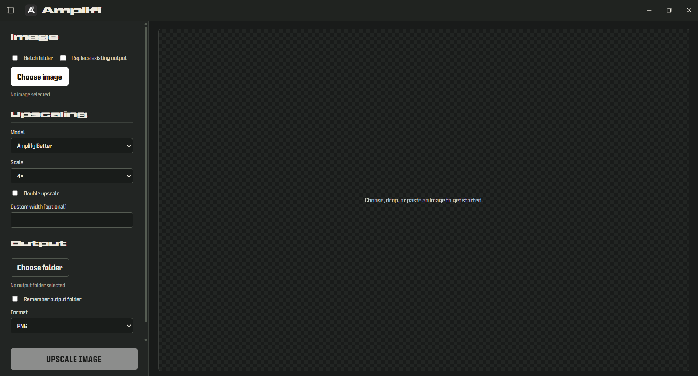

# Amplifi

**Version 0.0.100 · Windows x64**

Amplifi is a Windows desktop app for enlarging images with AI models. It runs the image processing engine locally, so images stay on your computer instead of being uploaded to a service.



[Download Amplifi for Windows — Velopack Setup.exe](https://github.com/susenayw/Amplifi/releases/download/v0.0.100/com.susenayw.amplifi-win-Setup.exe)

Want to choose the install folder? Use the [folder-choice installer ZIP](https://github.com/susenayw/Amplifi/releases/download/v0.0.100/Amplifi-0.0.100-Windows-Folder-Installer.zip). Also available: [MSI installer](https://github.com/susenayw/Amplifi/releases/download/v0.0.100/com.susenayw.amplifi-win.msi) · [all release files](https://github.com/susenayw/Amplifi/releases/tag/v0.0.100).

## Features

- Process one image or a batch locally with the bundled NCNN/Vulkan engine.
- Choose an upscaling model, output format, scale, output folder, and optional tiling.
- Compare the original and processed image in the built-in preview.
- Select an installation folder with the folder-choice ZIP. Extract it and run `Install Amplifi.cmd`.

## Included models

- **Amplifi** and **Amplifi Better** — Real-ESRGAN based models.
- **Digital Art** — Real-ESRGAN anime model.
- **High Fidelity** — HFA2k by Helaman (Philip Hofmann / Phhofm), licensed under CC BY 4.0; attribution is included in the app and bundled notices.

Remacri, UltraSharp, and UltraMix Balanced are not bundled because their CC BY-NC-SA 4.0 terms restrict commercial use. Custom models may have their own license terms. See [the model notices](amplifi-app/src-tauri/resources/licenses/ATTRIBUTION.md) and [OpenModelDB's license notes](https://openmodeldb.info/docs/licenses).

## Performance and tradeoffs

Amplifi uses Tauri for its desktop shell instead of bundling a full Chromium runtime, as Electron apps commonly do. The engine and model weights still add to the download size. There are no controlled size, memory, or speed benchmarks against other upscalers; performance depends on the image, model, GPU, drivers, and tile settings. A compatible Vulkan GPU is recommended.

Large images and high output scales can use substantial GPU and system memory. Tiling can help with memory pressure, usually with a speed tradeoff. Dedicated upscalers may offer more restoration tools or a larger model library.

## Install on Windows

- **Main download:** run `com.susenayw.amplifi-win-Setup.exe` for the Velopack per-user setup.
- **Choose a folder:** download and extract the folder-choice ZIP, then run `Install Amplifi.cmd`.
- **MSI:** choose per-user or per-machine install scope.
- **Portable:** download `com.susenayw.amplifi-win-Portable.zip` from the [release page](https://github.com/susenayw/Amplifi/releases/tag/v0.0.100).

The v0.0.100 release build and package metadata were verified. End-user installation and image-upscaling QA are still pending.

## Build from source

Install Node.js and Rust, then run these commands from `amplifi-app/`:

```powershell
npm ci
npm run tauri dev
```

Build the Windows app and its Velopack packages:

```powershell
npm run tauri build
.\packaging\velopack\Pack.ps1
```

Check the Rust shell and core:

```powershell
cargo check --manifest-path src-tauri/Cargo.toml
cargo test --manifest-path amplifi-core/Cargo.toml
```

## License and notices

Amplifi source is licensed under GNU AGPL-3.0; see [LICENSE](LICENSE). Bundled engine, runtime, and models have additional terms. Read the [complete third-party notices and model credits](amplifi-app/src-tauri/resources/licenses/ATTRIBUTION.md). Releases are not code-signed, so Windows may show a SmartScreen warning.
