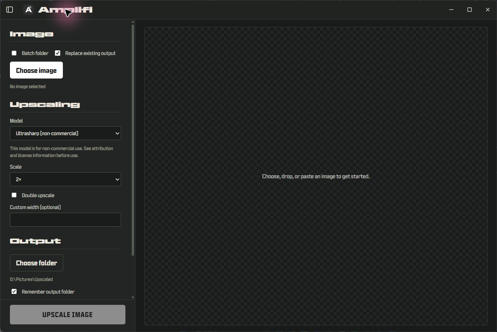

# Amplifi

**Current package version: 0.0.100**

Amplifi is a Windows-first desktop app for enlarging images with local AI models. It uses a Tauri interface and a bundled NCNN/Vulkan engine, so image processing runs on your computer without uploading images to a cloud service.

Modified for Amplifi on 2026-11-01 from the Upscayl project. Amplifi's source is offered under GNU AGPL-3.0. See [LICENSE](LICENSE) and the in-app **License and legal notices** section.



## How lightweight is it?

Amplifi uses Tauri for its desktop shell rather than packaging a full Chromium browser runtime as Electron apps commonly do. That can make the application shell and installed runtime footprint smaller than comparable Electron-based upscalers. Amplifi bundles its own engine and model weights, though, so the complete download is larger than the shell alone. No controlled size or memory benchmark is published here; actual memory use and speed vary with image dimensions, selected model, tile size, and GPU.

Upscaling itself is demanding work. Large images and high output scales can use substantial GPU memory and system memory, and may take a long time. Tiling can help with memory pressure, usually with a speed tradeoff. A compatible Vulkan GPU is recommended for the bundled NCNN/Vulkan engine; performance and compatibility depend on the device and drivers.

## Pros and tradeoffs

### Pros

- **Local processing:** images stay on your device during processing; no account or cloud upload is required.
- **Compact desktop shell:** Tauri avoids bundling a full Chromium runtime in the application shell.
- **Bundled workflow:** engine and model files are included with the Windows app, so there is no separate Python environment to set up.
- **Useful controls:** single-image and batch processing, model selection, output formats, optional tiling, and a before/after preview.

### Tradeoffs

- **Hardware dependent:** the NCNN/Vulkan engine needs a supported Vulkan device and suitable drivers for GPU acceleration. Compatibility varies, and CPU-only processing can be very slow or unavailable on some setups.
- **Large jobs need resources:** high-resolution inputs and outputs can consume considerable memory and processing time, even when the app shell is lightweight.
- **Bundled files add download size:** the engine and model weights increase the installed footprint beyond the Tauri UI itself.
- **Focused feature set:** dedicated upscalers may offer additional restoration tools, broader model libraries, cloud processing, or more polished batch-management features.
- **No benchmark claims:** there are no reproducible, same-hardware size, speed, or memory comparisons against other upscalers in this README.

## Included models

The bundled model set avoids model files with non-commercial restrictions:

- **Amplifi** and **Amplifi Better** — Real-ESRGAN based models.
- **Digital Art** — Real-ESRGAN anime model.
- **High Fidelity** — HFA2k by Helaman (Philip Hofmann / Phhofm), licensed under CC BY 4.0; attribution is included in the app and bundled notices.

Remacri, UltraSharp, and UltraMix Balanced are not included because their CC BY-NC-SA 4.0 terms restrict commercial purposes. You can still use a custom model folder, but you are responsible for the license terms of any model you add. A model's restrictions apply to the model asset; they do not automatically determine the copyright or license of an output image. See [OpenModelDB's model-license notes](https://openmodeldb.info/docs/licenses) and the [model notices](src-tauri/resources/licenses/ATTRIBUTION.md).

## Install on Windows

The release is packaged with Velopack. Run `com.susenayw.amplifi-win-Setup.exe` for the standard per-user installation. To choose a destination, extract `Amplifi-0.0.100-Windows-Folder-Installer.zip` and run `Install Amplifi.cmd`; it opens a folder picker and passes the selected path to Velopack. The MSI package lets the user choose a per-user or per-machine install scope.

Release files for this version are generated in `release/0.0.100/` by the packaging script.

## Build and run from source

Install Node.js and Rust, then install the frontend dependencies:

```sh
npm install
```

Run the desktop app in development mode:

```sh
npm run tauri dev
```

Build the frontend:

```sh
npm run build
```

Build the Windows app executable and resources:

```sh
npm run tauri build
```

Package the built app with Velopack (requires the vpk CLI):

```powershell
./packaging/velopack/Pack.ps1
```

Check the Tauri Rust shell:

```sh
cargo check --manifest-path src-tauri/Cargo.toml
```

Run core tests:

```sh
cargo test --manifest-path amplifi-core/Cargo.toml
```

Windows engine integration checks require the bundled engine resources and a compatible environment. The bundled resources and model weights live in `src-tauri/resources`.

## Third-party notices and source availability

The app and its bundled runtime include third-party software and models. Read [the complete notices and model credits](src-tauri/resources/licenses/ATTRIBUTION.md). The NCNN engine executable matches the official upstream release from June 1, 2024; the notices include its exact source commit and steps to retrieve its pinned source and submodules. The bundled Microsoft OpenMP runtime DLL is covered by Microsoft's separate Visual Studio license terms; it is not covered by Amplifi's AGPL license.

## Project status

Amplifi is a work in progress. Confirm that you meet Microsoft's Visual Studio licensing requirements for redistributing the unmodified OpenMP runtime DLL before publishing a Windows binary. Releases are not code-signed, so Windows may show a SmartScreen warning.
